<p align="center">
  
</p>

<p align="center"><b>Your game assets. At a glance.</b></p>

<p align="center">
  <a href="https://bozjator.itch.io/loot-silo"><b>⬇ Download Loot Silo on itch.io</b></a>
  &nbsp;·&nbsp; Linux · Windows · macOS &nbsp;·&nbsp; free, no account, no cloud
</p>

**Loot Silo is a game asset manager for indie game devs.** It is a desktop
asset library organizer and sprite / spritesheet viewer for everything you
have bought, bundled or downloaded: pixel art, tilesets, characters, UI,
VFX, sound effects, music and fonts. Import your packs once, then find any
sprite, sound or tileset in seconds, watch animations play, and copy the
credits into your game. It also works as an itch.io asset manager: link your
itch.io purchases and keep them in the same library.

<p align="center">
  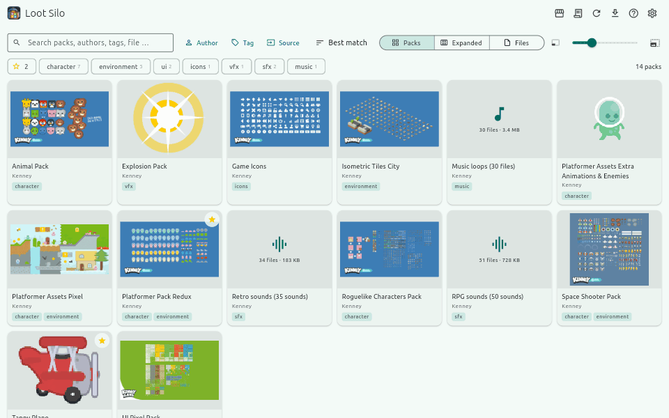
</p>

## Features

### Library and import

Drop in folders or archives (zip, tar, 7z, rar). Loot Silo finds the packs
inside, guesses author and type, shows you a review before anything is
copied, and checks every copied file against its SHA-1. Your library is one
folder arranged as `Author/Pack` — plain files you can open in any file
manager.

<p align="center">
  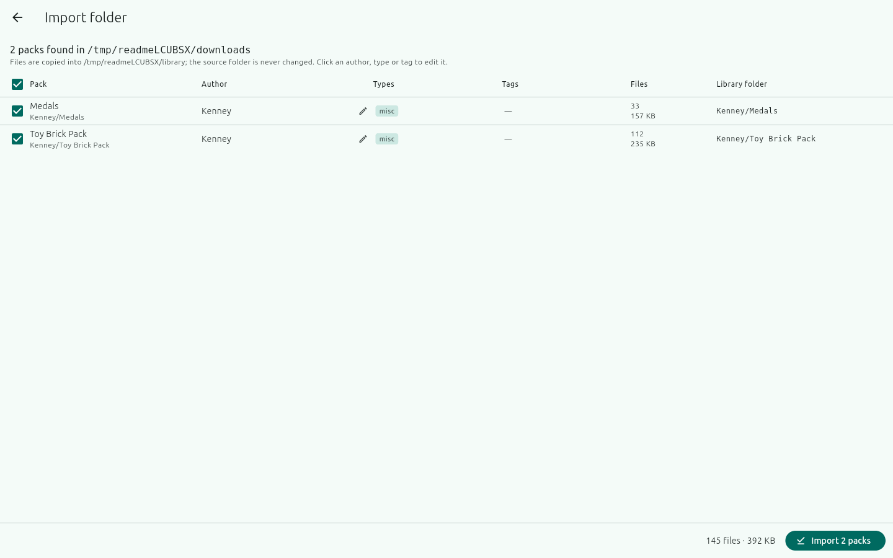
</p>

### Dashboard: search, filters and favorites

Search packs, authors, tags and file names as you type. Filter by type
(character, environment, UI, icons, VFX, SFX, music, 3D, font), author, tag
or source; star your favorite packs; sort by best match, name, author, size, file count, tags or type. Packs,
Expanded and Files views; a slider sets the thumbnail size.

<p align="center">
  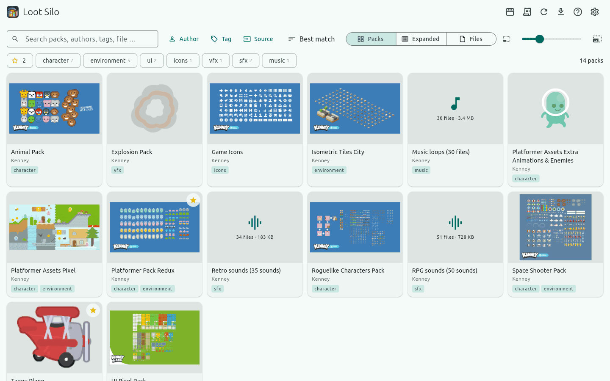
</p>

<p align="center">
  
</p>

<p align="center">
  
</p>

### Sprite sheet and animation detection

Open a pack to see its images, audio and other files. Sprite sheets, strips
and frame-per-file animations are detected and played automatically, at the
right frame size. When a guess is wrong, fix it in the Edit dialog: frame
width and height, frame count, FPS — or combine single frames into a strip.

<p align="center">
  
</p>

<p align="center">
  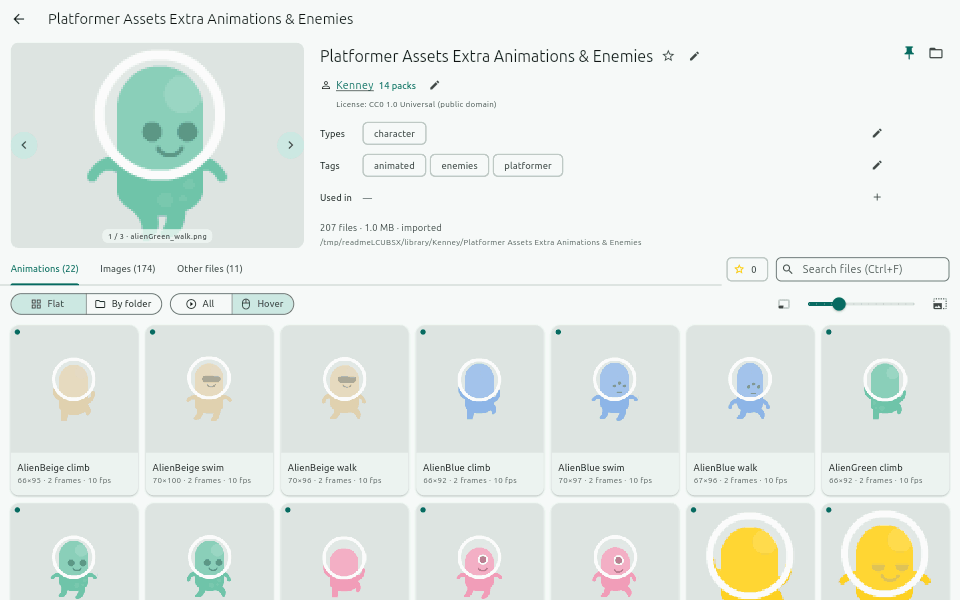
</p>

<p align="center">
  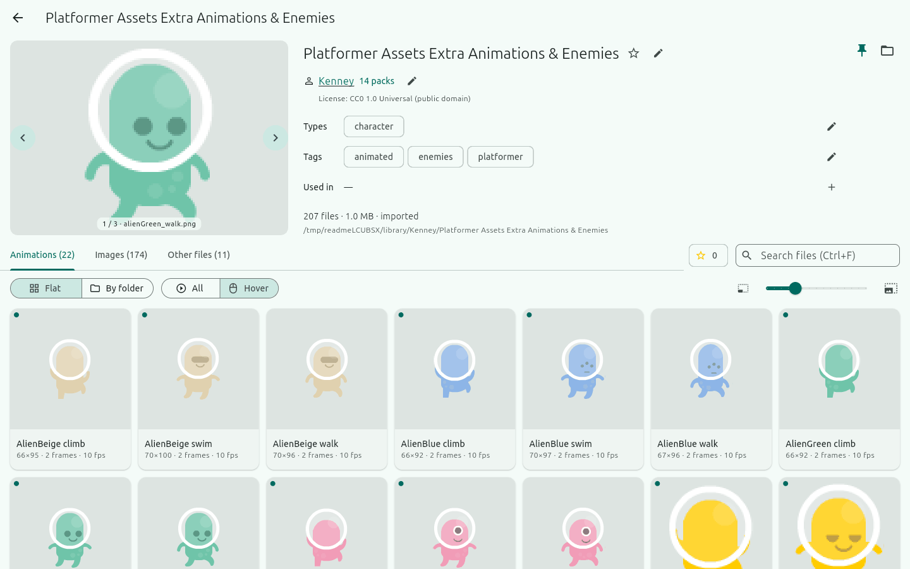
</p>

### Image viewer

Images open at 1:1, actual pixels as in your game, so pixel art stays crisp;
switch to Fit, zoom with the wheel and drag to pan.

<p align="center">
  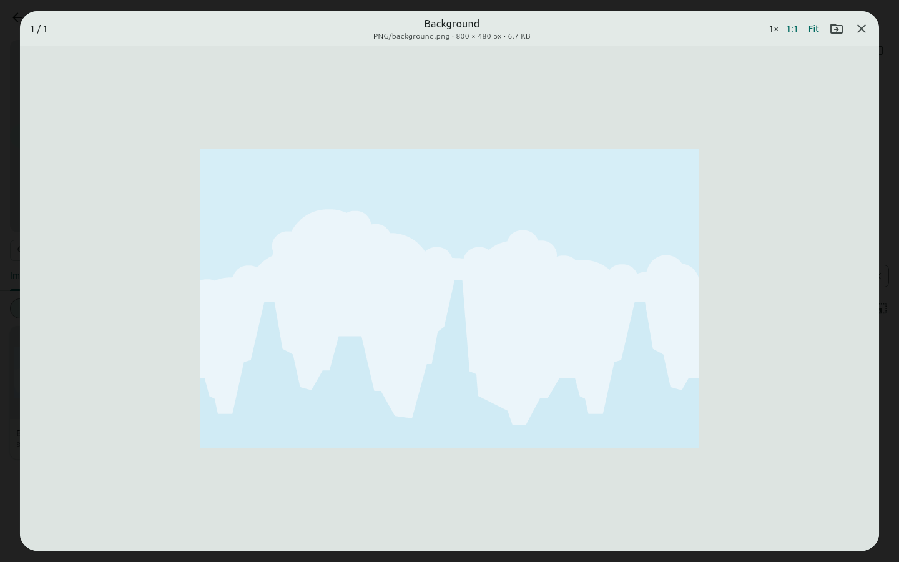
</p>

<p align="center">
  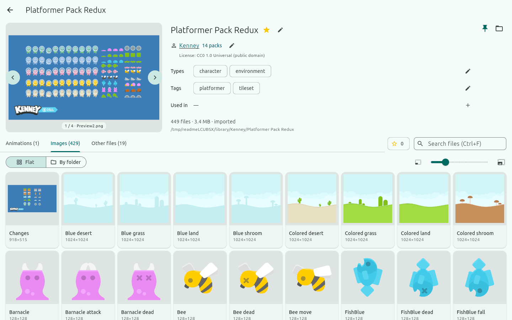
</p>

### Sound effects browser

Play sound effects and music loops right in the pack, with length and size
shown, Play all and Loop, so you find the right "jump" sound without opening
an audio editor.

<p align="center">
  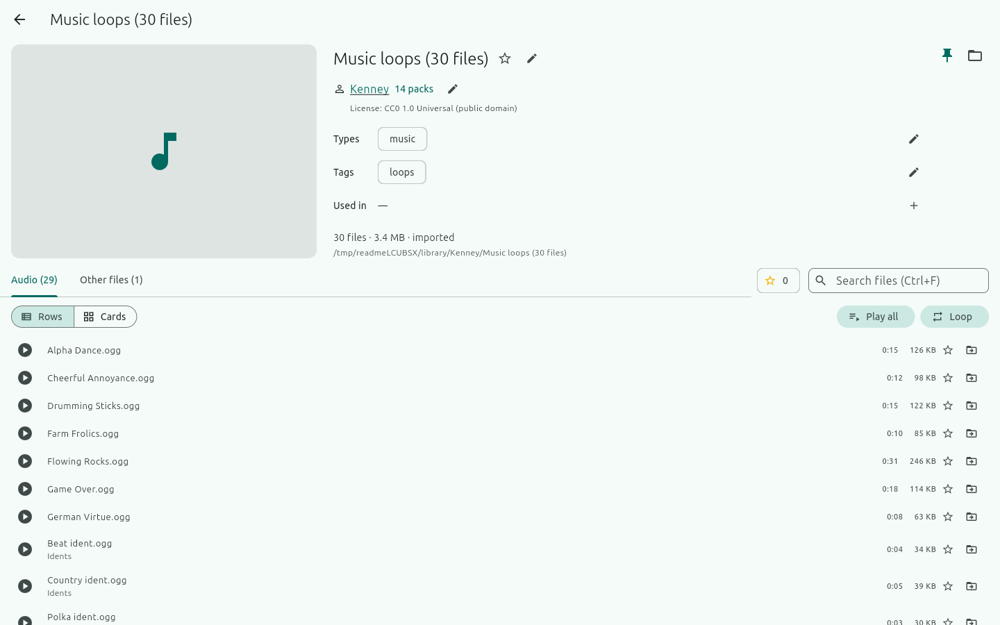
</p>

### Credits and licenses

Keep the license and attribution for every author, mark which packs a game
uses, and get the credits for that game ready to paste.

<p align="center">
  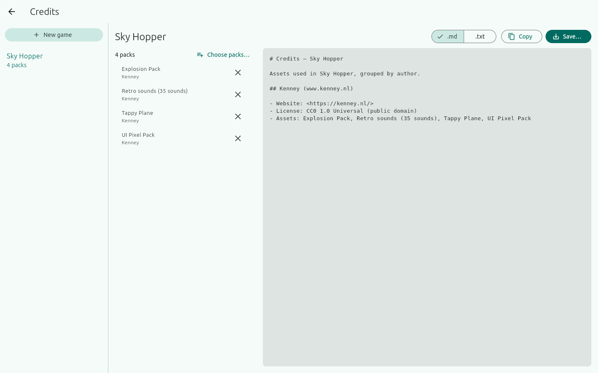
</p>

### itch.io sync

Add your itch.io API key (kept in the system keyring) and Loot Silo lists
your purchases, matches them to packs you already have, and imports the
rest.

### Tabs, resume and themes

Open packs in tabs (middle-click, Ctrl+Tab to switch); Loot Silo reopens where
you left off. Pick a colour theme, light or dark.

<p align="center">
  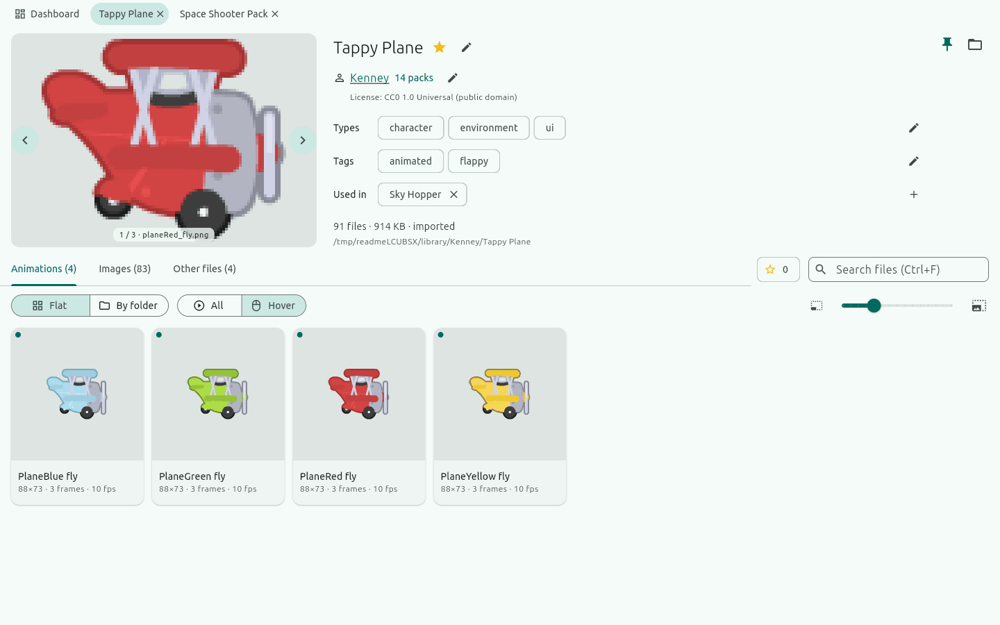
</p>

<p align="center">
  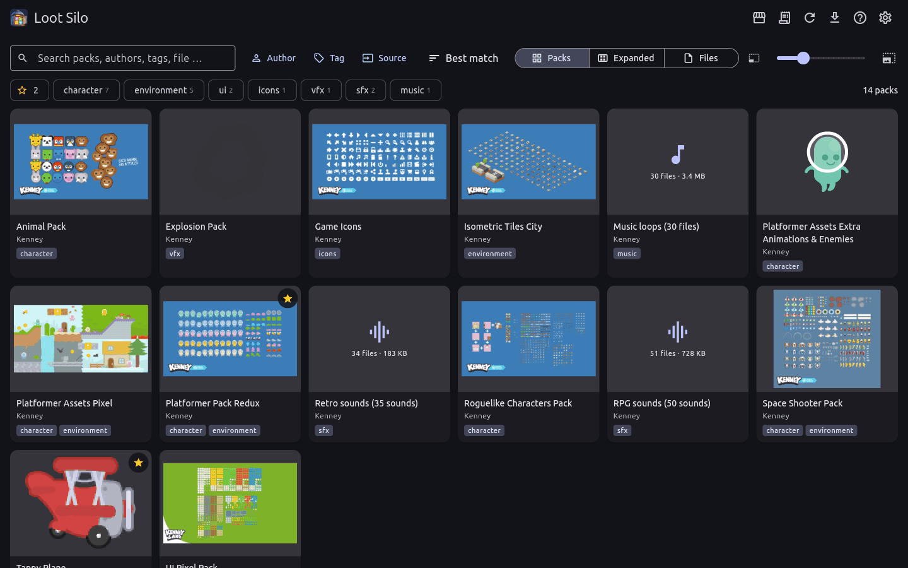
</p>

<p align="center">
  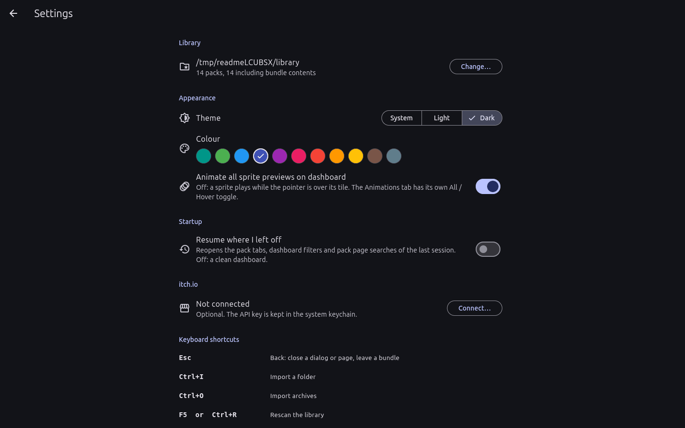
</p>

Press F1 in the app for the full guide and every keyboard shortcut.

## Why Loot Silo

- **Plain files.** One `ASSET_AUTHOR.txt` per author and one
  `asset_pack.json` per pack, both safe to edit by hand. Stop using Loot Silo
  and your library is still a tidy folder.
- **No cloud, no account.** Everything stays on your disk. The only network
  calls are the itch.io ones you turn on.
- **Made for game dev.** It knows what a sprite sheet, a tileset and a
  credits screen are.

## FAQ

**Which file formats does it support?**
Images: PNG, GIF, JPG, WebP, BMP, SVG, TGA (Aseprite and PSD files are
listed). Audio: OGG, WAV, MP3, FLAC, M4A, AIFF, Opus. Fonts: TTF, OTF, WOFF,
FNT. 3D models (GLB, glTF, FBX, OBJ, Blend, VOX …) are listed and counted.
Archives: zip, tar, 7z, rar.

**Where is my data stored?**
Your assets stay in the library folder you choose. Settings and a search
index (a cache that is rebuilt when needed) live in the app's data folder,
on Linux `~/.local/share/dev.uzo.loot_silo`.

**Is it free?**
Yes. Download it on [itch.io](https://bozjator.itch.io/loot-silo) or build
it from source.

**Can I sell it?**
No. You can use it, change it and share it, but not sell it or a product
that is mostly Loot Silo. See the [license](LICENSE).

## Build from source

Needs the Flutter SDK (stable) with Linux desktop support, plus
`libsecret-1-dev` (for the itch.io key) and, for 7z and rar archives, `7zz`,
`7z` or `unrar` on the PATH.

```bash
flutter pub get
flutter run -d linux
```

A release build lands in `build/linux/x64/release/bundle/`:

```bash
flutter build linux --release
```

Windows and macOS runners are included but not yet tested.

## Tests

```bash
dart format lib test integration_test
flutter analyze
flutter test
```

Integration tests drive the real app and write screenshots to `screenshots/`;
on a headless machine run them under Xvfb:

```bash
xvfb-run -a -s "-screen 0 1440x900x24" flutter test integration_test/app_test.dart -d linux
```

The README media is made by `tool/readme_media/make_media.sh` (needs Xvfb,
Pillow and a copy of the Kenney packs in `../assets_library`, read only). The branding assets are rebuilt with
`python3 tool/branding/make_branding.py`.

The packs shown in the screenshots are [Kenney](https://kenney.nl) packs
(CC0, public domain).

## License

Loot Silo is **source-available**, not open source in the OSI sense: the
[MIT License with the Commons Clause](LICENSE). Use it, change it, share it
— just don't sell it.

## Star us on GitHub

If Loot Silo saves you time, a ⭐ on GitHub helps other game devs find it.

<p align="center">
  <a href="https://bozjator.itch.io/loot-silo"><b>⬇ Download Loot Silo on itch.io</b></a>
</p>
