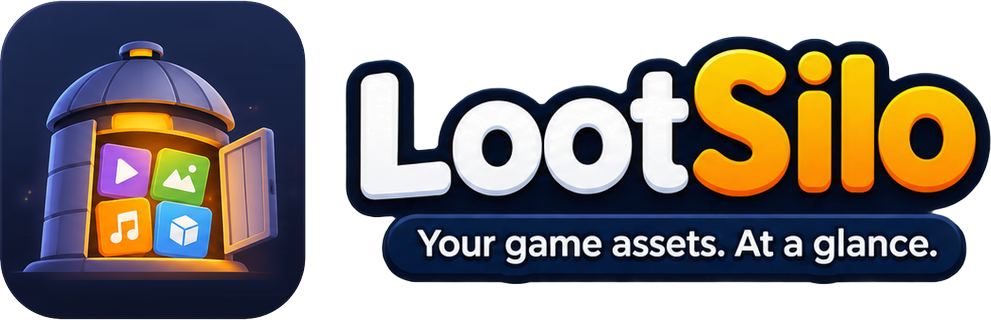
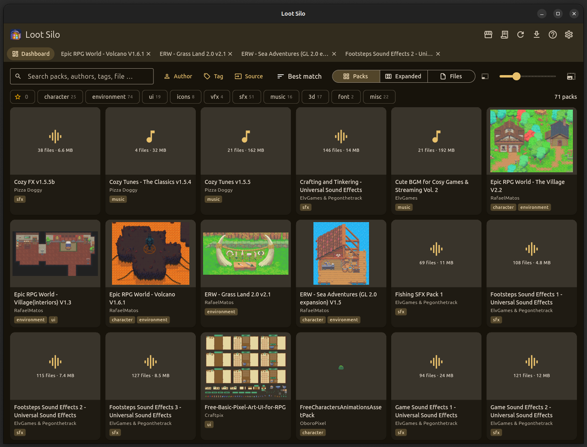
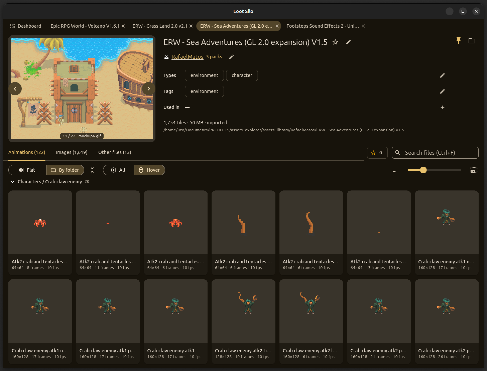
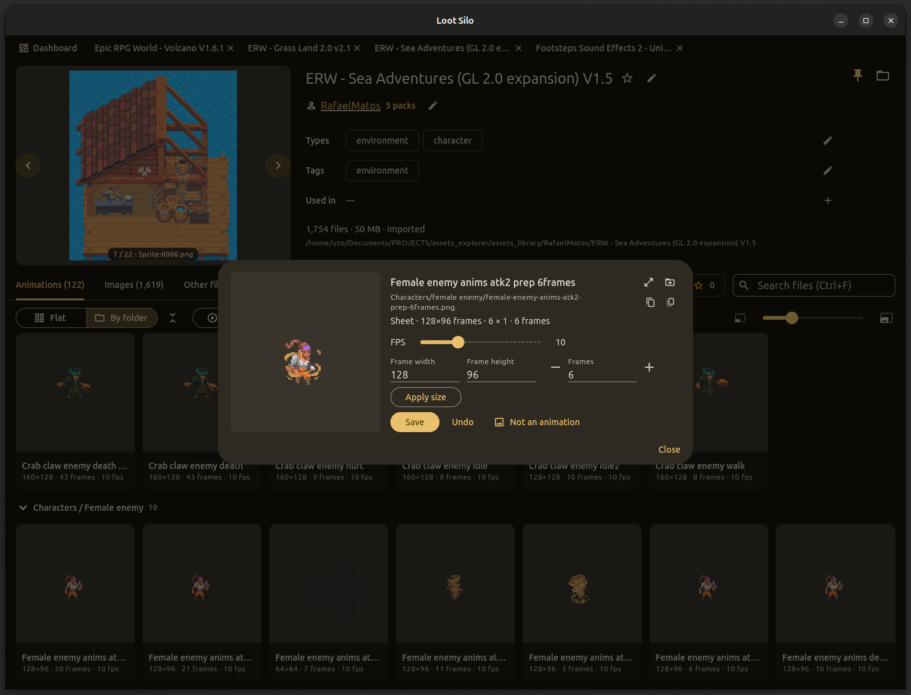

<p align="center">
  
</p>

<p align="center"><b>Your game assets explorer.</b></p>

<p align="center">
  <a href="https://bozjator.itch.io/loot-silo"><b>⬇ Download Loot Silo on itch.io</b></a>
  &nbsp;·&nbsp; Linux · Windows · macOS &nbsp;·&nbsp; free, no account, no cloud
</p>

**Loot Silo is a game asset manager for game devs.** It is a desktop
asset library organizer and sprite / spritesheet viewer for everything you
have bought, bundled or downloaded: pixel art, tilesets, characters, UI,
VFX, sound effects, music and fonts. Import your packs once, then find any
sprite, sound or tileset in seconds, watch animations play, and copy the
credits into your game. It also works as an itch.io asset manager: link your
itch.io purchases and keep them in the same library.

<p align="center">
  
</p>

## Features

### Library and import

Drop in folders or archives (zip, tar, 7z, rar), from the import menu or by
drag and drop. Loot Silo finds the packs inside, guesses author and type,
shows you a review before anything is copied, and checks every copied file
against its SHA-1. Your library is one folder arranged as `Author/Pack` —
plain files you can open in any file manager. Big collections become bundles
that hold sub-packs.

### Dashboard: search, filters and favorites

Search packs, authors, tags and file names as you type. Filter by type
(character, environment, UI, icons, VFX, SFX, music, 3D, material, font),
author, tag
or source; star your favorite packs; sort by best match, name, author, size,
file count, tags or type. Packs, Expanded and Files views; a slider sets the
thumbnail size, and pack covers play their animations.

### Sprite sheet and animation detection

Open a pack to see its animations, images, audio and other files, flat or
grouped by folder (collapse or expand every folder in one click). Sprite
sheets, strips, grids and frame-per-file animations are detected and played
automatically, at the right frame size — all at once or on hover.

<p align="center">
  
</p>

When a guess is wrong, fix it in the Edit dialog: frame width and height,
frame count, FPS, or mark the file "Not an animation". "Make animation…"
turns any image into a sheet, and you can combine single frame files into a
strip.

<p align="center">
  
</p>

### Image viewer

Images open at 1:1, actual pixels as in your game, so pixel art stays crisp
(an image bigger than the window opens fitted); switch to Fit, zoom with the
wheel and drag to pan. Focus mode steps through cards with the arrow keys.

### 3D models

The Models tab shows one card per model, whatever formats it comes in (GLB,
OBJ and FBX of the same tree are one card with a chip per format). GLB, glTF
and OBJ models are drawn in their own colours and textures; hover a card to
turn the model. Double-click for the model viewer: orbit, zoom and pan,
wireframe, flat colours, turntable and floor grid, with an info panel
(triangles, vertices, size, textures and materials) and the previous or next
model one key away.

### Materials

PBR texture sets (Color, Normal, Roughness, Metalness, AO … maps) become one
card per material in a Materials tab, grouped by their names or by a
MaterialX `.mtlx` file, so the maps no longer flood the Images tab. Hover a
card for its map chips and its files for other tools (MaterialX, Godot, USD,
Blender, Substance, Unity). The material viewer draws it on a lit sphere or
plane, tiled, or one map at a time; drag to move the light. Packs with
materials get the Material type, so you can filter for them on the dashboard.

### Sound effects browser

Play sound effects and music loops right in the pack, with length and size
shown, Play all and Loop, so you find the right "jump" sound without opening
an audio editor. Each sound shows its waveform (WAV, MP3 and Ogg Vorbis), so
a short click and a long whoosh look different before you play them; a sound
saved in several formats is one row with a chip per format.

### Credits and licenses

Keep the license and attribution for every author, mark which packs a game
uses, and get the credits for that game ready to paste.

### itch.io sync

Add your itch.io API key (kept in the system keyring) and Loot Silo lists
your purchases, matches them to packs you already have, and imports the
rest.

### Tabs, resume and themes

Open packs in tabs (middle-click, Ctrl+Tab to switch); Loot Silo reopens where
you left off — tabs, filters, sort and view. Pick a colour theme, light or
dark.

Press F1 in the app for the full guide and every keyboard shortcut.

## Why Loot Silo

- **Plain files.** One `ASSET_AUTHOR.txt` per author and one
  `asset_pack.json` per pack, both safe to edit by hand. Stop using Loot Silo
  and your library is still a tidy folder.
- **No cloud, no account.** Everything stays on your disk. The only network
  calls are the itch.io ones you turn on.
- **Made for game dev.** It knows what a sprite sheet, a tileset and a
  credits screen are.

## FAQ

**Which file formats does it support?**
Images: PNG, GIF, JPG, WebP, BMP, SVG, TGA (Aseprite and PSD files are
listed). Audio: OGG, WAV, MP3, FLAC, M4A, AIFF, Opus. Fonts: TTF, OTF, WOFF,
FNT. 3D models: GLB, glTF and OBJ are drawn; FBX, DAE, STL, Blend, 3DS and
VOX are listed. Materials: maps as PNG, JPG, WebP, BMP or GIF, plus MaterialX,
Godot (.tres), USD, Blender, Substance and Unity material files. Archives:
zip, tar, 7z, rar.

**Where is my data stored?**
Your assets stay in the library folder you choose. Settings and a search
index (a cache that is rebuilt when needed) live in the app's data folder.

**Is it free?**
Yes. Download it on [itch.io](https://bozjator.itch.io/loot-silo) or build
it from source.

**Can I sell it?**
No. You can use it, change it and share it, but not sell it or a product
that is mostly Loot Silo. See the [license](LICENSE).

## Build from source

Needs the Flutter SDK (stable) with Linux desktop support, plus
`libsecret-1-dev` (for the itch.io key) and, for 7z and rar archives, `7zz`,
`7z` or `unrar` on the PATH. On macOS the system `tar` reads most 7z and rar
archives; 7-Zip (`brew install sevenzip`) covers the rest, such as encrypted
or multi-volume ones.

```bash
flutter pub get
flutter run -d linux
```

A release build lands in `build/linux/x64/release/bundle/`:

```bash
flutter build linux --release
```

Windows and macOS runners are included but not yet tested.

### Branding

The app icon (window, taskbar and installer icons on Linux, Windows and
macOS) and the Loot Silo logo shown in the app and at the top of this README
are generated from two source images in `tool/branding/source/`. After
changing either one, regenerate the files (needs Pillow) and rebuild the app:

```bash
python3 tool/branding/make_branding.py
```

## Tests

```bash
dart format lib test integration_test
flutter analyze
flutter test
```

Integration tests drive the real app and write screenshots to `screenshots/`;
on a headless machine run them under Xvfb:

```bash
xvfb-run -a -s "-screen 0 1440x900x24" flutter test integration_test/app_test.dart -d linux
```

## License

Loot Silo is **source-available**, not open source in the OSI sense: the
[MIT License with the Commons Clause](LICENSE). Use it, change it, share it
— just don't sell it.

## Star us on GitHub

If Loot Silo saves you time, a ⭐ on GitHub helps other game devs find it.

<p align="center">
  <a href="https://bozjator.itch.io/loot-silo"><b>⬇ Download Loot Silo on itch.io</b></a>
</p>
